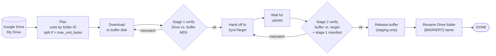

# ⛴️ skyferry

**The ferry between clouds.** It moves your Google Drive to another cloud, folder by folder, over weeks if need be, verifies every step, and picks up where it left off after any crash.

[](https://github.com/cubetribe/skyferry/actions/workflows/tests.yml)
[](https://github.com/cubetribe/skyferry/actions/workflows/secret-scan.yml)


> **Status: v0.1, alpha.** The engine is done and tested. The only finished target so far is a local folder. The Sync.com target is the next milestone and is looking for help. See [Status and roadmap](#status-and-roadmap).

---

## Why

Moving terabytes between clouds is mostly a patience problem. A single `rclone copy` assumes the data fits on the destination, that nothing fails for three weeks, and that you can trust the result without looking at it. skyferry is built for the opposite case: a small Linux box at home, an external disk as a buffer that is smaller than the dataset, and a target that has no API you can call.

It runs unattended, proves each folder is complete before it lets go of the local copy, marks finished folders visibly in the source, and tells you by push notification when something needs a human.

## How it works



Each folder (a "unit") carries its own state in SQLite, so every step is idempotent and a restart simply continues from the last recorded state.

## Safety guarantees

- **Google Drive is never deleted from.** The rclone wrapper only allows reads (`lsjson`, `lsf`, `size`, `copy` from Drive to local). The only write it permits is `moveto` that renames a folder to `[MIGRIERT] <name>` in the same parent folder. Everything else raises `SafetyError`, and the test suite checks that.
- **Local buffer data is deleted only after stage-2 verification passes**, and only inside the staging folder.
- **The buffer guard refuses to write** unless the disk is mounted and carries a marker file. The disk setup script also makes the empty mountpoint immutable, so a missing USB disk never fills the system SSD.
- **Renames never merge.** Before renaming, skyferry checks that the target name is free. Afterwards it checks that the folder ID is unchanged.
- **Duplicate names stop, not guess.** Drive allows two files with the same name in one folder, and rclone would silently collapse them. Such a unit goes to `NEEDS_ATTENTION`.
- **Nothing sensitive leaves the box by default.** See [Notifications and privacy](#notifications-and-privacy).

## Features

- Folder-by-folder units keyed by Drive folder ID, with recursive splitting of large folders
- Two-stage verification: MD5 against Drive, then the target against the buffer plus a manifest check for bit rot
- Google Docs are exported to `docx`, `xlsx`, `pptx`, `svg` (no MD5 exists, so existence and size > 0 are checked)
- Resumable: kill it at any time, restart, and it continues. A kill-and-resume test covers this
- Retries with deferral for temporary rclone errors and transfer limits, then `FAILED` with an alarm
- Append-only audit trail (`events`) and a human-readable plan report per run
- Push notifications via [ntfy](https://ntfy.sh) and a dead man's switch via [healthchecks.io](https://healthchecks.io)
- Runs as a systemd user service with `Restart=on-failure` and an alarm unit for crashes
- Standard library only (Python 3.12). rclone runs as a subprocess

## Quickstart

This walks through a homelab server with a USB disk attached. Anything that runs Linux with systemd works. The full guide is in [docs/SETUP.md](docs/SETUP.md) (German version: [docs/de/EINRICHTUNG.md](docs/de/EINRICHTUNG.md)).

**You need:** a Linux server with Python 3.12, rclone 1.75 or newer on your `PATH` (or in `~/.local/bin`), a Google account, an external USB disk for the buffer, and a free ntfy and healthchecks.io account if you want notifications.

Replace `<server>` with your SSH host alias and `<SERIAL>` with the disk serial.

```bash
# 1. Optional, only for the Sync.com spike: Wine and friends (needs sudo once)
ssh -t <server> 'bash -s' < setup/homelab-packages.sh

# 2. Connect Google Drive. The browser login happens on your laptop through an SSH tunnel.
./setup/gdrive-connect.sh <server>

# 3. Copy the project to the server and install it (no sudo)
rsync -a --delete --exclude .git --exclude reports --exclude plans ./ <server>:~/skyferry/
ssh <server> 'bash ~/skyferry/deploy/install.sh'
ssh <server> 'loginctl enable-linger $USER'

# 4. Prepare the buffer disk. This ERASES the disk and asks you to type LOESCHEN.
rsync -a setup/ <server>:~/skyferry-setup/
ssh -t <server> 'sudo bash ~/skyferry-setup/buffer-disk.sh <SERIAL> $USER'

# 5. Edit the config on the server
ssh -t <server> 'nano ~/.config/skyferry/config.toml'

# 6. Dry run, then the real plan, then one supervised run
ssh <server> 'cd ~/skyferry && python3 -m skyferry plan --dry-run'
ssh <server> 'cd ~/skyferry && python3 -m skyferry plan'
ssh <server> 'cd ~/skyferry && python3 -m skyferry run --once'

# 7. Notifications work? Then let it run unattended
ssh <server> 'cd ~/skyferry && python3 -m skyferry notify-test'
ssh <server> 'systemctl --user enable --now skyferry.service'
```

Check progress any time with `python3 -m skyferry status`.

## CLI reference

Run from the project directory: `python3 -m skyferry [--config PATH] [-v] <command>`. The config defaults to `~/.config/skyferry/config.toml` (or `$SKYFERRY_CONFIG`).

| Command | Purpose |
|---|---|
| `plan [--dry-run]` | Stream the Drive inventory, plan units, write a report. `--dry-run` prints statistics and saves nothing. |
| `run [--once] [--max-units N]` | Run the migration. `--once` exits as soon as no further progress is possible. `--max-units` caps new downloads. |
| `status [--json]` | Counts per status, bytes done, throughput over 24 h, ETA, active downloads, recent events. |
| `units [--status STATE]` | List units, optionally filtered by state. |
| `events [--unit N] [--tail N]` | Show the append-only audit trail. |
| `retry <id>` / `retry --failed` | Reset a `FAILED` or `NEEDS_ATTENTION` unit and resume it. |
| `skip <id> --reason TEXT` | Mark a unit `SKIPPED`. Its Drive folder is not renamed. |
| `verify <id> [--stage local\|remote]` | Re-run a verification stage for one unit. Default stage: `local`. |
| `verify --all-done` | Audit every finished unit against the target. |
| `notify-test` | Send a test message to ntfy and ping healthchecks.io. |
| `notify-alarm TEXT` | Send an alarm. Used by the systemd `OnFailure` unit. |

Exit codes: `0` success, `1` error (rclone or safety), `2` configuration error or buffer guard during `--once`, `3` another instance is running.

## Unit states

```
PLANNED → DOWNLOADING → DOWNLOADED → VERIFIED_LOCAL → STAGED → UPLOADED → VERIFIED_REMOTE → RELEASED → RENAMED → DONE
```

Side states: `FAILED` (retries used up, alarm sent), `NEEDS_ATTENTION` (for example duplicate names in Drive or a rename that is not safe), `SKIPPED` (set by hand).

## Configuration highlights

The complete, commented reference is [`config.example.toml`](config.example.toml). The settings you are most likely to change:

| Setting | What it does |
|---|---|
| `source.root_folder_id` | Empty means all of My Drive. Set a folder ID to migrate only that subtree. |
| `source.done_prefix` | Marker prefix for finished folders. Default `[MIGRIERT] `. |
| `buffer.mount` / `buffer.max_unit_bytes` | Where the buffer lives and the size above which folders are split. |
| `buffer.reserve_bytes` | Free space that is never written to. |
| `rclone.bwlimit` | Bandwidth schedule, for example `08:00,20M 23:00,off`. |
| `run.max_attempts` | Attempts per unit before `FAILED`. |
| `notify.stall_hours` | Alarm if nothing progresses for this long. |
| `notify.include_paths` | `false` by default. Keep it that way unless you accept folder names leaving the box. |

Keep your real `config.toml` out of version control. It holds the ntfy topic and the healthchecks URL. The file is created with mode `0600`.

## Notifications and privacy

- **ntfy** receives failures, stalls, buffer problems, a daily summary and batched "units done" messages. A topic name works like a password, so pick a long, random one.
- **healthchecks.io** receives a start signal, a heartbeat every few minutes, a `/fail` on fatal errors. If the box goes silent for longer than the grace period, it alerts you, which covers power loss, crashes and a dead service.
- **Privacy by default:** with `notify.include_paths = false`, messages contain only unit numbers, sizes, statuses and error classes. Folder and file names never leave the machine. They can contain client names, which is the reason this default exists. Full paths stay in local logs and reports.

## Architecture

| Module | Responsibility |
|---|---|
| `skyferry/cli.py` | Command-line interface |
| `skyferry/app.py` | Wires configuration, state, rclone, buffer, target and notifier together |
| `skyferry/config.py` | TOML loading and validation |
| `skyferry/planner.py` | Drive tree to units, with splitting for large folders |
| `skyferry/source.py` | Drive inventory, unit listings, the safe rename |
| `skyferry/rclone.py` | rclone wrapper and the source safety net (`SafetyError`) |
| `skyferry/runner.py` | State machine, main loop, instance lock, signal handling |
| `skyferry/verify.py` | Listing comparison for stage 1, stage 2 and audits |
| `skyferry/buffer.py` | Buffer guard, deletes only inside staging |
| `skyferry/state.py` | SQLite state, units, events, key-value store |
| `skyferry/notify.py` | ntfy and healthchecks.io, rate limiting, privacy filter |
| `skyferry/targets/base.py` | The `SyncTarget` protocol |
| `skyferry/targets/folder.py` | `FolderTarget`, a local folder as target |
| `deploy/` | systemd user service, failure alarm unit, `install.sh` |
| `setup/` | Server helpers: packages, Google connection, buffer disk |
| `spike/wine/` | Experiments for running the Sync.com Windows client under Wine |
| `tests/` | 48 tests, including end-to-end, kill-and-resume, corruption and safety-net tests |

Adding a cloud target means implementing `SyncTarget`: `stage`, `upload_state`, `remote_listing` and `release`. The engine does the rest.

## Status and roadmap

**Done (v0.1):**

- The migration engine, state machine and two-stage verification
- Safety net for the Drive remote, buffer guard, safe renames
- Notifications, systemd service, server setup helpers
- 48 tests, run in CI

**Not done yet:**

- **Sync.com target.** Sync.com has no public API, no Linux client, no WebDAV and no rclone backend. The planned approach is **Plan A**: run the official classic Windows client (2.2.x, not the CloudFiles build) headless under Wine and Xvfb on the server. Helpers live in `spike/wine/`. **Plan B** is browser automation of the web panel.
- **Verification against a real Google Drive.** Three things still need a real-world check: the listing shape of Google Docs, folder-ID preservation after a rename, and `--fast-list` memory use at terabyte scale.
- **English user interface.** The CLI and the notification texts are currently German. Localisation is on the roadmap.

**Help wanted:** if you have run Sync.com under Wine, or know how to automate its web panel reliably, please open an issue. Localising the CLI into English is a great first contribution, too. Look for issues labelled `good first issue`.

## FAQ

**Why not just `rclone copy`?**
`rclone copy` is excellent for moving data between clouds that have an API and enough space. skyferry handles what it does not cover:

- **Weeks-long unattended runs** with a restart-safe state machine, not a single command that must survive from start to finish.
- **A buffer smaller than the dataset.** Data is downloaded, verified, handed off and released in pieces.
- **A target without an API.** The `SyncTarget` protocol lets you wait for a desktop client to finish syncing, then verify what actually arrived.
- **Proof of completeness per folder.** Every folder is checked twice, by MD5 against the source and against the target, before its local copy is released.
- **A visible done marker in the source.** Finished folders are renamed `[MIGRIERT] …`, so anyone looking at Drive can see progress.
- **Alerting and resumability.** You are told when something needs attention, and nothing is lost when the power goes out.

**Can it delete things in my Google Drive?**
No. The wrapper refuses every delete, purge, move, sync and dedupe call against the source. It only allows reads and the exact rename described above. The tests check this.

**Does it need root?**
Only for two optional steps: installing Wine and the other packages, and formatting the buffer disk and writing `/etc/fstab`. The service itself runs as your user with no sudo.

**Why is the Sync.com target missing?**
Sync.com does not offer an API or a Linux client. Building the target needs a working way to drive its client, and that is an open problem. See the roadmap.

**Is it safe to use with confidential data?**
The code only talks to Google Drive via rclone, to the target you configure, to ntfy and to healthchecks.io. With the default privacy setting, the two notification services receive no folder or file names. Read the code and the tests before trusting it with anything important. This is alpha software.

**The development was AI-assisted. Is that a concern?**
It was developed in the open with [Claude Code](https://claude.com/claude-code), in sprints orchestrated by AI agents. The plans, sprint specs and agent reports are in `plans/` and `reports/`, so you can see how decisions were made and checked. Every change still goes through the same tests and CI gates as any human contribution.

## Contributing

Contributions are welcome. Please read [CONTRIBUTING.md](CONTRIBUTING.md) first. In short: standard library only, type hints, English identifiers, tests for new behaviour, and the secret-scan hook installed before your first commit.

## Security

Found a vulnerability? Please do not open a public issue. Use GitHub's private reporting described in [SECURITY.md](SECURITY.md).

## License

[MIT](LICENSE) © 2026 Dennis Westermann
